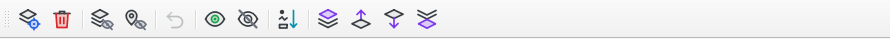
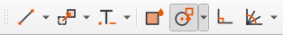
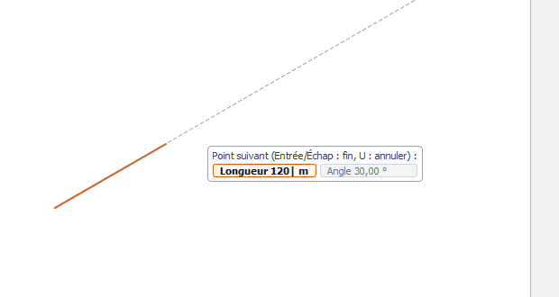
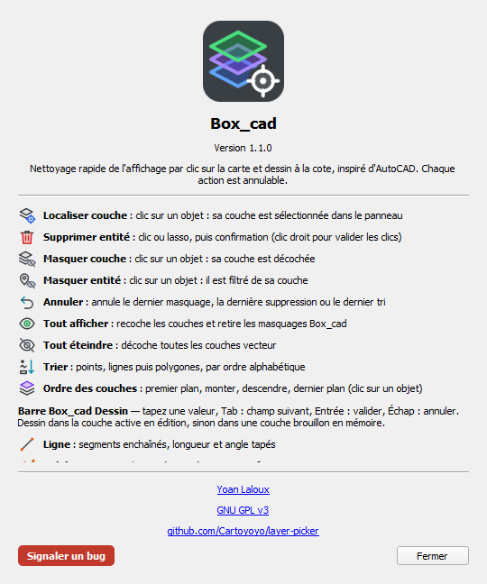
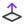
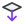
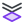

<div align="center">

# Box_cad


**Deux barres d'outils QGIS façon AutoCAD : nettoyer l'affichage d'un clic sur la carte, et dessiner à la cote**

[](https://qgis.org)
[](metadata.txt)
[](LICENSE)
[](#français)

</div>

---

<div align="center">

## Aperçu rapide · Quick Overview

| Barre d'outils · Toolbar |
|:---:|
|  |
| Localiser et supprimer — masquer — annuler — tout afficher / éteindre — trier — ordre des couches |

| Barre Dessin · Drawing toolbar | Saisie près du curseur · Dynamic input |
|:---:|:---:|
|  |  |
| Ligne — polyligne — rectangle — rectangle orienté — carré — cercle — rotation — gomme<br>ortho (F8) | Longueur en cours de frappe<br>et angle près du curseur |

| À propos · About |
|:---:|
|  |
| Aide-mémoire des outils<br>intégré au plugin |

</div>

---

## Français

### Description

Box_cad ajoute à QGIS une barre de 12 outils qui agissent **directement sur l'objet cliqué** : retrouver sa couche, la masquer, masquer ou supprimer l'objet, ou changer l'ordre d'affichage de sa couche.

Fini les allers-retours entre la carte et un panneau de couches de 40 lignes : cliquez sur ce qui vous gêne, Box_cad trouve la bonne couche et agit dessus. Chaque action se défait avec le bouton Annuler.

### Fonctionnalités

| Icône | Outil | Action |
|:---:|---|---|
|  | **Localiser couche** | Clic sur un objet : sa couche devient active et est sélectionnée dans le panneau des couches |
|  | **Supprimer entité** | Clic (cumulable, validé par clic droit) ou lasso libre, puis confirmation |
|  | **Masquer couche** | Clic sur un objet : sa couche est décochée |
|  | **Masquer entité** | Clic sur un objet : il est retiré de l'affichage par un filtre de couche |
|  | **Annuler** | Défait les dernières actions une à une, jusqu'à 50 (masquages, suppressions, tri, dessins, gomme, transformations, propriétés) ; l'infobulle indique la prochaine action annulée |
|  | **Tout afficher** | Recoche toutes les couches vecteur et retire les masquages faits par Box_cad |
|  | **Tout éteindre** | Décoche toutes les couches vecteur (annulable en une fois) |
|  | **Trier par géométrie** | Points, puis lignes, puis polygones, par ordre alphabétique, dans chaque groupe |
|  | **Premier plan** | Clic sur un objet : sa couche passe en tête de son groupe |
|  | **Monter d'un niveau** | Clic sur un objet : sa couche monte d'un cran |
|  | **Descendre d'un niveau** | Clic sur un objet : sa couche descend d'un cran |
|  | **Dernier plan** | Clic sur un objet : sa couche passe en fin de son groupe |

- **Bouton à menu « Ordre des couches »** : le tri et les 4 outils d'ordre partagent un seul bouton, qui affiche le dernier utilisé (un clic le relance, la flèche ouvre la liste).
- **Cotes associatives** : Déplacer, Rotation, Miroir ou Échelle d'une forme entraîne les cotes et angles posés sur elle (longueur recalculée ; une cote accrochée à un seul coin s'allonge) ; un seul Annuler remet le tout. Déplacer une cote ou un angle ne bouge que la ligne de cote ou l'arc : les points mesurés restent, les rappels s'adaptent.
- **Désignation (Déplacer, Rotation, Gomme, Propriétés…)** : les annotations (textes, cotes, angles) passent avant les formes et se désignent aussi par leur texte ; une forme vide (cercle, rectangle non rempli) se désigne par son contour ou son centre, pas par l'intérieur.
- **Clic sur l'objet du dessus** : tous les outils visent l'objet vecteur le plus haut sous le curseur, quelle que soit la couche active.
- **Filtres respectés** : masquer une entité s'ajoute au filtre déjà posé sur la couche, et « Tout afficher » rend ce filtre intact.
- **Suppression prudente** : confirmation systématique ; si la couche était déjà en édition, la suppression reste dans votre session d'édition au lieu d'être enregistrée d'office.
- **Lasso multi-couches** : un tracé libre sélectionne les objets de toutes les couches visibles modifiables, même si le tracé se recoupe.
- **Tri sans casse** : les sous-groupes restent à leur place ; seules les couches sont réordonnées.
- **Touche Échap** : annule la sélection en cours de l'outil Supprimer.
- **Menu Extensions → Box_cad** : tous les outils et la fenêtre « À propos » y sont aussi accessibles.

### Barre Box_cad Dessin

Comme dans AutoCAD, on clique un premier point puis on **tape les valeurs** dans les champs qui suivent le curseur : la souris ne donne plus que la direction. Près du curseur, seules les valeurs s'affichent ; l'étape en cours, le nom des champs (champ actif en gras) et les touches sont dans la **barre d'état** de QGIS.

Les outils sont rangés dans **3 boutons à menu** — **Tracer ▾**, **Modifier ▾**, **Annoter ▾** — qui affichent le dernier outil utilisé (un clic le relance, la flèche ouvre la liste), suivis des modes Remplissage, Accrochage et Ortho, puis d'une **pastille** qui montre la couleur, l'épaisseur et la couche qui recevra le dessin (clic : propriétés courantes). Tous les outils sont aussi dans le menu *Extensions → Box_cad*, rangé comme CanaPlan : Annuler en tête, puis un sous-menu par thème — Objets, Affichage, Ordre des couches, Tracer, Modifier, Annoter, Modes de dessin — et À propos.

| Icône | Outil | Étapes | Champs |
|:---:|---|---|---|
|  | **Ligne** | P1 → P2 → P3… (une entité par segment) | Longueur, angle |
|  | **Polyligne** | P1 → P2 → … ; Entrée ou clic droit termine, **C** ferme | Longueur, angle |
|  | **Rectangle** | coin → coin opposé | Largeur, hauteur |
|  | **Rectangle orienté** | coin → premier côté → hauteur | Longueur, angle, puis hauteur |
|  | **Carré** | coin → côté (construit à gauche du côté) | Côté, angle |
|  | **Polygone** | un clic par sommet → Entrée, clic droit ou C ferme (U : annuler le dernier sommet) | Longueur, angle (relatif dès le 2e côté) |
|  | **Cercle** | centre → rayon (polygone à 72 segments) | Rayon |
|  | **Texte** | point d'insertion → angle (Entrée : 0°) → texte et taille | Angle ; taille en points (fixe à l'écran) |
|  | **Cote** | point 1 → point 2 → position de la cote (Entrée : sans décalage) | Longueur, angle, puis décalage |
|  | **Angle** | clic sur 2 lignes (ou Entrée : sommet → un point sur chaque côté) → position de l'arc : le côté choisi donne l'angle, son supplémentaire ou l'angle rentrant | Longueur, angle (mode 3 points), puis rayon |
|  | **Déplacer** | objet → point de base → point d'arrivée | Longueur, angle |
|  | **Copier** | objet → point de base → un clic par copie → Entrée | Longueur, angle |
|  | **Rotation** | objet → point de base (Entrée : son centre) → angle | Angle (anti-horaire) |
|  | **Miroir** | objet → 2 points de l'axe (l'objet est retourné) | Angle de l'axe |
|  | **Échelle** | objet → point de base (Entrée : centre) → facteur | Facteur ; **R** : longueur actuelle → nouvelle |
|  | **Gomme** | clic sur une forme, ou cliquer-glisser (lasso) pour en effacer plusieurs | — |
|  | **Propriétés** | clic sur une forme dessinée ; Entrée sans objet : propriétés courantes | Couleur, épaisseur, trait, remplissage, opacité, texte |
|  | **Remplissage** | bouton à bascule : actif = rectangles, carrés, cercles remplis ; inactif = vides | — |
|  | **Accrochage objet (F3)** | actif par défaut ; flèche du bouton : modes à cocher (mémorisés) | — |
|  | **Ortho (F8)** | angles limités à 0 / 90 / 180 / 270° | — |

| Touche | Effet |
|:---:|---|
| chiffres | saisie dans le champ actif (l'aperçu suit la valeur tapée) |
| Tab | champ suivant ; la valeur tapée est verrouillée |
| Entrée | valide le point ; sans saisie, termine la commande |
| Échap | efface la saisie, puis annule la commande |
| U ou Retour arrière | annule le dernier point (ou le dernier segment de Ligne) |
| A | Ligne / Polyligne : bascule l'angle entre relatif et absolu |
| F3 | active / désactive l'accrochage objet |

- **Angle relatif** : dès le 2e segment d'une ligne ou polyligne, l'angle tapé est une déviation par rapport au segment précédent (0 = tout droit, +90 = virage à gauche, −90 = à droite) ; l'ortho s'aimante aussi par rapport à ce segment. La touche A repasse en angle absolu.
- **Conventions AutoCAD** : angles en degrés, 0° = est, sens anti-horaire ; longueurs en unités de la carte (mètres en Lambert 93).
- **Couche cible** : la couche active si elle est en édition et du bon type (ligne ou polygone), avec le formulaire d'attributs QGIS et Ctrl+Z ; sinon une couche brouillon **en mémoire** « Box_cad dessin – lignes / polygones » (champs `outil`, `longueur`, `surface`), à exporter pour la conserver.
- **Accrochage objet Box_cad (façon OSNAP)**, indépendant de la configuration d'accrochage QGIS : un marqueur vert s'affiche sur le point, et son nom (« Centre », « Quadrant »…) dans la barre d'état.

  | Mode | Point |
  |---|---|
  | Extrémité □ | sommets, coins, points |
  | Milieu △ | milieu des segments |
  | Centre ○ | centre exact d'un cercle, centre géométrique d'un polygone |
  | Quadrant ◇ | points à 0 / 90 / 180 / 270° d'un cercle |
  | Opposé ✕ | point diamétralement opposé au point précédent (cote d'un diamètre) |
  | Intersection ✕ | croisement de deux objets (segments et cercles, calcul exact) |
  | Perpendiculaire ▽ | pied de la perpendiculaire depuis le point précédent |
  | Proche ⧗ | n'importe quel point d'un segment ou de la circonférence |

  Les cercles, centres de polygones, quadrants et points opposés sont reconnus sur les **dessins Box_cad** (lus directement). Sur vos **autres couches**, Box_cad s'appuie sur les index de QGIS, construits en arrière-plan sans bloquer : extrémité, milieu, intersection, perpendiculaire et proche. Une couche dont l'index est en cours de construction (quelques secondes, une seule fois) n'est pas encore accrochable. Si rien n'est trouvé, l'accrochage QGIS habituel s'applique (s'il est activé) ; l'accrochage l'emporte sur l'ortho, comme dans AutoCAD.
- **Remplissage** : désactivé par défaut, les formes sont vides (contour seul) ; chaque forme garde son état dans le champ `rempli` de la couche brouillon.
- **Cote** : ligne de cote fléchée, lignes de rappel et étiquette de longueur, dans la couche brouillon « Box_cad dessin – cotes ».
- **Déplacer, Copier, Miroir, Échelle** (et Rotation) : agissent sur les formes dessinées (bouton Annuler) et sur la couche active en édition (Ctrl+Z). Une copie dans une couche de données reprend les attributs mais pas la clé primaire (nouveau fid), et ne recopie pas les objets liés par relation.
- **Texte** : brouillon « Box_cad dessin – textes » ; taille en points, fixe à l'écran ; angle anti-horaire comme dans AutoCAD. Un texte se désigne en cliquant n'importe où sur ses lettres : Déplacer, Copier, Gomme et Propriétés s'y appliquent ; la Rotation l'incline, l'Échelle change sa taille, le Miroir le reporte de l'autre côté de l'axe en le gardant lisible.
- **Propriétés** : couleur, épaisseur, type de trait (continu, tirets, pointillés, mixte), remplissage et opacité, forme par forme, sur les dessins Box_cad uniquement ; la case « Utiliser pour les prochaines formes » les rend courantes (mémorisées).
- **Rotation** : agit sur les formes dessinées (bouton Annuler) et sur la couche active en édition (Ctrl+Z) ; l'objet tourné est prévisualisé en bleu, l'angle suit la souris ou se tape, l'ortho l'aimante.
- **Gomme** : n'agit que sur les couches brouillon « Box_cad dessin » visibles, jamais sur vos données ; la forme visée est surlignée en rouge (la plus petite si plusieurs se superposent) ; le bouton Annuler restaure le dernier effacement.

### Prérequis

QGIS 3.16 ou plus récent. Aucune dépendance externe.

### Installation

1. Cloner le dépôt :
   ```bash
   git clone https://github.com/Cartoyoyo/Box_Cad.git Box_cad
   ```
2. Copier le dossier `Box_cad` dans le répertoire des extensions QGIS :

   | Système | Chemin |
   |---------|--------|
   | Windows | `C:\Users\<utilisateur>\AppData\Roaming\QGIS\QGIS3\profiles\default\python\plugins\` |
   | macOS   | `~/Library/Application Support/QGIS/QGIS3/profiles/default/python/plugins/` |
   | Linux   | `~/.local/share/QGIS/QGIS3/profiles/default/python/plugins/` |

3. Dans QGIS : *Extensions → Installer/Gérer les extensions → Installées*, cocher **Box_cad**.
4. La barre d'outils **Box_cad** apparaît, ainsi que le menu *Extensions → Box_cad*.

### Utilisation

1. Activer un outil de la barre (il reste enfoncé tant qu'il est actif).
2. Cliquer sur un objet de la carte : l'action s'applique à cet objet ou à sa couche.
3. Pour **Supprimer** : cliquer sur plusieurs objets puis faire un **clic droit** pour confirmer, ou tracer un **lasso** (confirmation immédiate). Échap abandonne la sélection.
4. Une erreur ? Le bouton **Annuler** défait la dernière action.

### Limites connues

- **Annulation** : 50 actions au plus ; la pile est vidée à la fermeture du projet et au rechargement du plugin.
- **Cercle** : polygone à 72 segments, sa surface vaut 99,87 % de celle du cercle parfait.
- **Couches brouillon** : en mémoire, elles disparaissent à la fermeture de QGIS si elles ne sont pas exportées.
- **Masquer entité** passe par le filtre de la couche : impossible sur une couche en cours d'édition, et sur une base de données la couche doit avoir une clé primaire.
- **Tri par géométrie** : l'ordre alphabétique peut placer un polygone opaque (une commune, par exemple) au-dessus d'autres polygones. Le bouton Annuler rétablit l'ordre précédent.

---

## English

### Description

Box_cad adds a 12-tool QGIS toolbar that acts **directly on the clicked feature**: find its layer, hide it, hide or delete the feature, or change its layer's drawing order.

No more back-and-forth between the map and a 40-row layers panel: click what is in your way, Box_cad finds the right layer and acts on it. Every action can be undone.

### Features

- **Locate layer**: click a feature to make its layer active and selected in the Layers panel.
- **Delete feature**: cumulative clicks (confirmed with right-click) or freehand lasso, always with a confirmation dialog.
- **Hide layer / Hide feature**: uncheck the clicked feature's layer, or filter the feature out of its layer.
- **Undo**: reverts the last hide, delete or sort.
- **Show all / Hide all**: re-check every vector layer and remove Box_cad's filters, or uncheck every vector layer.
- **Sort by geometry**: points, then lines, then polygons, alphabetical, inside each group; subgroups stay in place.
- **Layer order by click**: to top, up, down, to bottom.
- **Existing filters kept**: hiding a feature adds to the layer's current filter; *Show all* restores it untouched.
- **Safe delete**: if the layer is already in edit mode, the deletion stays in your edit session instead of being committed.
- **Drawing toolbar (AutoCAD style)**: line, polyline, rectangle, rotated rectangle, square, circle, rotation (draft shapes or active layer in edit mode) and an eraser for draft shapes. Click a first point, then type length / angle / width / height / radius in the fields next to the cursor (Tab next field, Enter validate, Esc cancel, U undo last point). Snapping and ortho (F8). Shapes go to the active layer when it is in edit mode and of the right type, otherwise to an in-memory draft layer.

### Requirements

QGIS 3.16 or later. No external dependency.

### Installation

1. `git clone https://github.com/Cartoyoyo/Box_Cad.git Box_cad`
2. Copy the `Box_cad` folder into the QGIS plugins directory (see the table in the French section).
3. In QGIS: *Plugins → Manage and Install Plugins → Installed*, enable **Box_cad**.
4. The **Box_cad** toolbar and the *Plugins → Box_cad* menu appear.

### Usage

Activate a tool, then click a feature on the map. For **Delete**, click several features and right-click to confirm, or draw a lasso. **Esc** clears the pending selection. **Undo** reverts the last action.

### Known limitations

Only the last action can be undone. *Hide feature* uses the layer filter: not available while the layer is being edited, and database layers need a primary key.

---

## Español

> Las capturas de pantalla se encuentran en la sección [Aperçu rapide](#aperçu-rapide--quick-overview) al inicio de este documento.

### Descripción

Box_cad añade a QGIS una barra de 12 herramientas que actúan directamente sobre el objeto pulsado: localizar su capa, ocultarla, ocultar o eliminar el objeto, o cambiar el orden de su capa. Cada acción se puede deshacer.

### Funcionalidades

- **Localizar capa**, **eliminar entidad** (clic o lazo, con confirmación), **ocultar capa**, **ocultar entidad**.
- **Deshacer**, **mostrar todo**, **apagar todo**.
- **Ordenar por geometría** (puntos, líneas, polígonos) y **orden de capas** por clic.
- **Barra de dibujo** estilo AutoCAD: línea, polilínea, rectángulo, cuadrado y círculo con longitudes y ángulos tecleados.

### Instalación

Copiar la carpeta `Box_cad` en el directorio de complementos de QGIS y activarla en *Complementos → Administrar e instalar complementos*.

---

## Português

> As capturas de ecrã encontram-se na secção [Aperçu rapide](#aperçu-rapide--quick-overview) no início deste documento.

### Descrição

O Box_cad adiciona ao QGIS uma barra de 12 ferramentas que atuam diretamente sobre o objeto clicado: localizar a sua camada, ocultá-la, ocultar ou eliminar o objeto, ou alterar a ordem da camada. Cada ação pode ser anulada.

### Funcionalidades

- **Localizar camada**, **eliminar elemento** (clique ou laço, com confirmação), **ocultar camada**, **ocultar elemento**.
- **Anular**, **mostrar tudo**, **apagar tudo**.
- **Ordenar por geometria** (pontos, linhas, polígonos) e **ordem das camadas** por clique.
- **Barra de desenho** estilo AutoCAD: linha, polilinha, retângulo, quadrado e círculo com comprimentos e ângulos digitados.

### Instalação

Copiar a pasta `Box_cad` para o diretório de módulos do QGIS e ativá-la em *Módulos → Gerir e instalar módulos*.

---

## Deutsch

> Die Bildschirmfotos befinden sich im Abschnitt [Aperçu rapide](#aperçu-rapide--quick-overview) am Anfang dieses Dokuments.

### Beschreibung

Box_cad fügt QGIS eine Werkzeugleiste mit 12 Werkzeugen hinzu, die direkt auf das angeklickte Objekt wirken: seinen Layer finden, ausblenden, das Objekt ausblenden oder löschen, oder die Layer-Reihenfolge ändern. Jede Aktion lässt sich rückgängig machen.

### Funktionen

- **Layer finden**, **Objekt löschen** (Klick oder Lasso, mit Bestätigung), **Layer ausblenden**, **Objekt ausblenden**.
- **Rückgängig**, **alles einblenden**, **alles ausblenden**.
- **Nach Geometrie sortieren** (Punkte, Linien, Polygone) und **Layer-Reihenfolge** per Klick.
- **Zeichenleiste** im AutoCAD-Stil: Linie, Polylinie, Rechteck, Quadrat und Kreis mit eingetippten Längen und Winkeln.

### Installation

Den Ordner `Box_cad` in das QGIS-Erweiterungsverzeichnis kopieren und unter *Erweiterungen → Erweiterungen verwalten und installieren* aktivieren.

---

## Architecture

| Fichier | Rôle |
|---|---|
| `plugin_main.py` | Barre d'outils, menu, actions et annulation |
| `_identify_enums.py` | Base commune des outils « clic sur un objet » |
| `map_tool_*.py` | Un outil de carte par fonction (localiser, masquer, supprimer, ordre) |
| `draw/` | Barre Dessin : géométrie pure, saisie dynamique, outils, couche cible |
| `about_dialog.py` | Fenêtre « À propos » |
| `icons/` | Icônes SVG de la barre |

---

## Changelog

Le détail est dans [`CHANGELOG.md`](CHANGELOG.md).

| Version | Notes |
|---------|-------|
| **1.1.0** | Barre Box_cad Dessin en 3 menus — Déplacer, Copier, Miroir, Échelle — Polygone — Texte — Propriétés — Accrochage objet (F3) — Cote — Angle — Remplissage à la demande — Angle relatif — Rotation — Gomme — Saisie dynamique près du curseur — Accrochage, ortho — Couche active ou brouillon mémoire |
| **1.0.0** | Première version publique — Jeu d'icônes harmonisé — Filtres de couche conservés — Suppression sans enregistrement forcé — Tri annulable — Menu Extensions et fenêtre À propos — Compatibilité Qt6 |

---

## Auteur · Author

<div align="center">

Développé par / Developed by **Yoan Laloux**

Technicien SIG — Vichy Communauté · GIS Technician — Vichy Communauté

[](https://www.linkedin.com/in/ylaloux/)
[](https://github.com/Cartoyoyo)

*Concept et idée originale par Yoan Laloux — développé avec l'assistance d'outils d'IA générative.*
*Concept and original idea by Yoan Laloux — developed with the assistance of generative AI tools.*

</div>

---

## Licence · License

Ce plugin est distribué sous licence **GNU GPL v3** — voir [`LICENSE`](LICENSE).
This plugin is released under the **GNU GPL v3** license — see [`LICENSE`](LICENSE).

Signaler un problème · Report an issue : [github.com/Cartoyoyo/Box_Cad/issues](https://github.com/Cartoyoyo/Box_Cad/issues)
